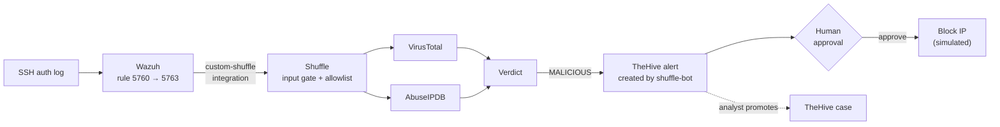
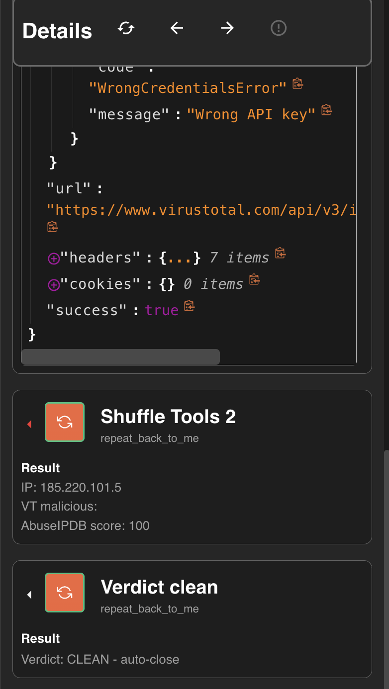
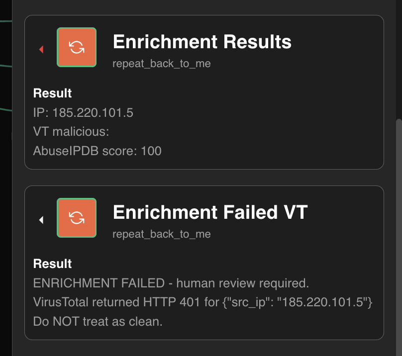

# SOAR Home Lab — Wazuh · Shuffle · TheHive · VirusTotal · AbuseIPDB

A detection-to-response pipeline built from scratch on a single machine. A SIEM detects an
attack, a SOAR platform validates and enriches it, a TheHive alert is raised automatically for
an analyst to promote to a case, and containment waits for a human to approve it. Then I broke
it on purpose, documented how it failed, and fixed it.



## Chaos testing, before and after

The same corrupted VirusTotal API key, fired at a known Tor exit node (`185.220.101.5`,
AbuseIPDB score 100), before and after hardening:

| Before — `ip_enrichment_v1` | After — `brute_force_response_v3` |
|---|---|
|  |  |
| VirusTotal answers `401 WrongCredentialsError`, Shuffle still reports `success: true`, the empty count is read as 0 — and the attacker is auto-closed as **CLEAN**. | Verdicts now require HTTP 200 from both lookups, so the run goes to `Enrichment Failed VT` — *Do NOT treat as clean* — for human review. (Taken before a message-formatting fix; it prints the whole payload where it now prints only the IP.) |

All twelve before-and-after screenshots, with what each one proves: [`evidence/`](evidence/README.md).

## Highlights

- **Fully automated detection to TheHive alert in 10–12 seconds.** A Wazuh brute-force alert
  reaches Shuffle, is enriched by two threat-intel sources in parallel, and becomes a TheHive
  alert with no human involved. Measured at 10.6 s and 12.1 s from the Wazuh alert timestamp to
  TheHive's creation time. [Details](architecture.md#measured-latency) ·
  [Chapter 6](chapters/Chapter-06-SIEM-Integration.md) · [Chapter 8](chapters/Chapter-08-Case-Management-Response.md)
- **Human-gated containment with a two-identity audit trail.** The playbook pauses before the
  block. The alert is created by a service account (`shuffle-bot`); a named analyst reviews it,
  promotes it to a case, and approves the block — and Shuffle records the approver's identity.
- **Link-only phishing caught with zero reputation signal.** A typosquatted sender with a clean
  attachment scored 0 on VirusTotal for both domain and file. A Python scoring step flagged it
  anyway — typosquat of `microsoft` (+40) and an unregistered sender domain (+30) gave a score
  of 70 → PHISHING. The hash-only decision it replaced auto-closed the same email as benign.
- **Chaos-tested: found 4 fail-open defects in my own playbooks.** A dead API key, garbage
  input, a missing field and a three-character code injection each produced an auto-closed
  "clean" verdict for a known attacker or a malicious email. Each is fixed and re-tested in the
  playbook it affected, but not everywhere: the phishing playbook can still fail open on a dead
  key. [Results below](#chaos-testing)
- **Exports are scrubbed before they're published.** Shuffle exports keys typed into node fields
  as plaintext, so I wrote a [scrubber](tools/scrub_workflow.py) that redacts API keys, webhook
  IDs and email addresses, and refuses to write its output if any known secret survives.

## Architecture

| System | Role | In this lab |
|---|---|---|
| **Wazuh** | SIEM: decoding, correlation, alerting | 4.14.8, single node |
| **Shuffle** | SOAR: runs the playbooks | self-hosted, Docker |
| **VirusTotal** | IP, domain and file-hash reputation | API v3, free tier |
| **AbuseIPDB** | crowd-sourced IP abuse score | API v2, free tier |
| **TheHive** | case management: alerts, cases, observables | 5.4 |

Full diagram, payload contract, decision points, identities and networking:
**[architecture.md](architecture.md)**.

## Playbooks

| Playbook | Triggered by | What it does |
|---|---|---|
| [`brute_force_response_v3`](playbooks/brute_force_response_v3.json) | Wazuh rule 5763 via the integration | Validates the source IP, checks an allowlist, enriches with VirusTotal + AbuseIPDB in parallel, opens a TheHive alert with the IP as an IOC observable, and waits for approval before a (simulated) block. **[Playbook README](playbooks/brute_force_response_v3.README.md)** |
| [`phishing_triage_v3`](playbooks/phishing_triage_v3.json) | a reported email posted to a webhook | Validates sender domain and attachment hash, extracts and refangs IOCs from the body, checks domain and hash reputation, then scores the email in Python: typosquat detection, domain age via RDAP, weighted risk score with a SUSPICIOUS tier that routes to a human. |
| [`ip_enrichment_v1`](playbooks/ip_enrichment_v1.json) | a webhook carrying an IP | The original enrichment playbook. **Kept unfixed** as the baseline the chaos tests were run against. |

The Wazuh side lives in [`integrations/`](integrations/): the
[payload adapter](integrations/custom-shuffle) that reshapes Wazuh alerts for the playbook, and
the [integration config](integrations/ossec-integration.xml), which subscribes to the
`authentication_failures` rule group at level 10 rather than to a single rule ID.

## Chaos testing

Each test was run against the playbook where the defect lived, then repeated against its
hardened successor. Screenshots of every before and after are in [`evidence/`](evidence/README.md).

| Test | Found in | Before | Fixed in | After |
|---|---|---|---|---|
| Corrupt the VirusTotal API key | `ip_enrichment_v1` | HTTP 401, but Shuffle reported the node as successful; empty count read as 0 → **CLEAN** for a known Tor exit node | `brute_force_response_v3` | Verdicts require HTTP 200 from both lookups → `Enrichment_Failed_VT`, human review |
| Send `"src_ip": "not-an-ip"` | `ip_enrichment_v1` | VirusTotal 404, AbuseIPDB 422 → **CLEAN** | `brute_force_response_v3` | Rejected at the input gate, **zero API calls** |
| Omit `src_ip` entirely | `ip_enrichment_v1` | AbuseIPDB called with an empty IP → **CLEAN** | `brute_force_response_v3` | Rejected at the input gate, zero API calls |
| Put `"""` in the sender domain | `phishing_triage_v2` | Closed a string inside the Python scoring code → syntax error → crash read as **BENIGN** | `phishing_triage_v3` | Rejected at the input gate; the scoring code never runs |

`ip_enrichment_v1` is kept unfixed as the baseline. The dead-key fix was never applied to the
phishing playbook — see [Findings and limitations](#findings-and-limitations).

Two lessons came out of this that weren't in the plan:

- **Shuffle reports `success: true` on HTTP 401, 404 and 422.** The request completed, so the
  node "succeeded". Fail-closed checks have to test the status code, not the success flag.
- **Validate input as data, not code.** The injection existed because Shuffle substitutes
  variables into Python source as text. Escaping only raised the bar — triple quotes took three
  characters to break instead of one. The fix was an allowlist pattern checked in an edge
  condition, which compares the value as data and never executes it. Enterprise platforms solve
  the same problem by passing script inputs as arguments
  (`demisto.args()` in Cortex XSOAR, function parameters in Splunk SOAR custom functions).

## Measured results

| Metric | Value |
|---|---|
| Detection → TheHive alert | 10.6 s and 12.1 s across two runs |
| SSH failures before the brute-force rule fires | 10 from one IP within 120 s — the rule says `frequency="8"`, but it fired on the 10th |
| Brute-force rules covered by the integration's group subscription | 52 correlated `authentication_failures` rules at level ≥ 10 |
| Known-malicious Tor exit `185.220.101.5` | VirusTotal 10–12 malicious engines over three weeks of testing; AbuseIPDB 100 |
| Gated input, allowlisted or invalid | 0 API calls spent |

TheHive's alert view shows a detection time of "< 1 second". That measures from the alert's
`date` field, which this pipeline doesn't set, so TheHive fills in the moment the alert arrived.
The end-to-end figure above comes from comparing the Wazuh and TheHive timestamps directly.

## Design decisions

- **Correlated alerts only.** Wazuh rolls single failed logins (rule 5760, level 5) into one
  brute-force alert (rule 5763, level 10). The SOAR subscribes to the correlated alert — one
  playbook run per attack, not per password guess.
- **Multi-source enrichment.** No single field is trusted. `8.8.8.8` carries a 2023 threat-feed
  entry naming it an AsyncRAT C2 server, 59 community "malicious" votes and 198 abuse reports —
  and is Google's public DNS. The decision uses computed scores, and known infrastructure is
  allowlisted before any lookup.
- **Service account for automation.** The SOAR authenticates to TheHive as a service account
  that has no password and can't log in to the UI. Anything it does is attributable to the
  automation, never to a person.
- **Deduplication key.** The TheHive alert's `sourceRef` combines rule ID and source IP, so that
  TheHive *can* reject a repeat of the same detection instead of opening a second alert. Whether
  it does was not exercised in this lab — see [Findings and limitations](#findings-and-limitations).
- **Gate the destructive step.** Investigation is automated; containment is not.

## Findings and limitations

The honest section: known gaps, found in testing or by reading the code. None of them is
fixed yet.

- **`phishing_triage_v3` doesn't check its VirusTotal lookups.** If a lookup fails, its count
  defaults to 0 and scoring falls back on typosquat and domain-age signals alone. That's the same
  fail-open pattern the brute-force playbook was hardened against.
- **The typosquat check can be bypassed by subdomain.** `microsoft.login-verify.xyz` contains
  the brand name, so the check's exemption for genuine brand domains lets it through — even
  though the domain actually registered is `login-verify.xyz`. The fix is to compare against
  the registrable domain. *(Found by reading the code; not run.)*
- **Low-and-slow brute force is invisible.** An attacker who stays under ten failures per
  120 seconds per IP, or spreads attempts across many IPs, never triggers the correlated rule.
- **An RDAP timeout scores like an unregistered domain.** Both add the same +30, so an outage
  in the lookup service would push every email's score up at once.
- **The brute-force verdict uses VirusTotal alone.** AbuseIPDB must answer successfully and its
  score is shown to the analyst, but it doesn't influence the decision.
- **TheHive alert creation isn't status-checked.** If TheHive is down, the run still reaches the
  approval gate, so a block could be approved with no alert on record.
- **IPv4 only.** IPv6 sources are rejected rather than enriched.
- **The phishing input gate is case-sensitive.** A sender domain or hash in capitals is rejected
  as invalid. That fails safe, but would flood the queue with false rejections on real mail.
- **Deduplication is untested.** The `sourceRef` key has no time component, so the same rule
  firing for the same IP weeks later is expected to collide with the old alert rather than open
  a new one — and since alert creation isn't status-checked, the run would continue anyway.
- **Lab, not production.** Attacks are replayed log lines, the firewall block is simulated,
  phishing reports are posted directly rather than received from a mail gateway, and
  thresholds have never been measured against real analyst outcomes.

## Mapping to enterprise SOAR

| This lab | Splunk SOAR | Cortex XSOAR |
|---|---|---|
| Shuffle workflow | Playbook | Playbook |
| App + configured credentials | App + Asset | Integration + Instance |
| `$exec` trigger data | Container + artifacts | Incident context |
| TheHive observable | Artifact | Indicator |
| Execute Python node | Custom function | Automation script |
| User Input approval gate | Prompt block | Manual / conditional task |
| `sourceRef` deduplication | `source_data_identifier` | Pre-process rules |
| Service account `shuffle-bot` | Automation user | Integration credentials |

## Repository layout

```
├── README.md
├── architecture.md          diagram, data contract, decision points, measurements
├── chapters/                all nine chapters (1–9) with their screenshots and correction notes
├── evidence/                screenshots of each test, with an index
├── integrations/
│   ├── custom-shuffle       Wazuh → Shuffle payload adapter
│   └── ossec-integration.xml
├── playbooks/               sanitized Shuffle exports
└── tools/
    └── scrub_workflow.py    redacts secrets from exports; fails closed
```

## Running it yourself

Every playbook export is sanitized: API keys appear as `<REDACTED:…>` placeholders and webhook
IDs are replaced with dummy UUIDs. In outline:

1. Deploy Shuffle, Wazuh (single node) and TheHive 5 in Docker. On one machine, Wazuh's host
   ports 9200 and 1514 clash with Shuffle's and must be remapped.
2. Import the playbook JSON into Shuffle and replace each placeholder with your own key.
3. Install [`integrations/custom-shuffle`](integrations/custom-shuffle) in the Wazuh manager and
   add the [integration block](integrations/ossec-integration.xml), pointing `hook_url` at your
   playbook's webhook.
4. Create a TheHive service account for the SOAR and use its API key in the alert node.

[`architecture.md`](architecture.md) documents the ports, networking and payload format.

## Lab environment

Apple Silicon MacBook Air (16 GB, 10 GB allocated to Docker). All five systems run locally;
only the VirusTotal and AbuseIPDB lookups leave the machine.
