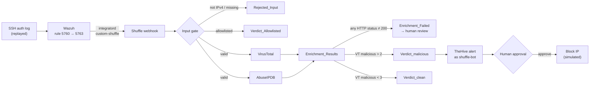

# Architecture

Five systems, one pipeline: an attack is detected by the SIEM, enriched and decided on by the
SOAR, recorded as a case, and contained only after a human approves.

| System | Role | Version / mode in this lab |
|---|---|---|
| **Wazuh** | SIEM — decodes logs, correlates events, raises alerts | 4.14.8, single node (manager, indexer, dashboard) |
| **Shuffle** | SOAR — runs the playbooks | self-hosted in Docker |
| **VirusTotal** | IP / domain / file-hash reputation | public API v3, free tier |
| **AbuseIPDB** | IP abuse reports and confidence score | public API v2, free tier |
| **TheHive** | Case management — alerts, cases, observables | 5.4 standalone (BerkeleyDB + Lucene, not Cassandra) |

Everything runs on one machine: a 16 GB Apple Silicon Mac with 10 GB given to Docker.

## Brute-force pipeline (`brute_force_response_v3`)



### Detection

- **Rule 5760** (level 5) fires on each `Failed password` line — an atomic event.
- **Rule 5763** (level 10) is the correlated rule: repeated 5760 events from the same source IP
  within 120 seconds. Its definition says `frequency="8"`, but in testing it fired on the
  **10th** attempt. It also has `ignore="60"`, suppressing repeats for a minute.
- Only correlated alerts reach the SOAR. The integration subscribes to
  `<group>authentication_failures</group>` at `<level>10</level>` — the category of brute-force
  rules, not one rule ID that could be renumbered between Wazuh versions.

### Hand-off: Wazuh → Shuffle

Wazuh's raw alert JSON doesn't match what the playbook expects, so the integration script
[`integrations/custom-shuffle`](integrations/custom-shuffle) reshapes it at the source:

```json
{"src_ip": "185.220.101.5", "rule_id": "5763",
 "rule_desc": "sshd: brute force trying to get access to the system. Authentication failed.",
 "level": 10, "full_log": "<original log line>"}
```

The webhook URL is passed in by Wazuh at runtime and never stored in the script. Configuration:
[`integrations/ossec-integration.xml`](integrations/ossec-integration.xml).

### Decision points

1. **Input gate** — `src_ip` must match a strict IPv4 pattern, checked in an edge condition so
   the value is compared as data and never spliced into code.
2. **Allowlist** — known-good addresses (public DNS resolvers, the company VPN) skip enrichment,
   so the SOAR can never recommend blocking its own infrastructure.
3. **Fail-closed enrichment** — a verdict requires *both* lookups to return HTTP 200. Shuffle
   reports `success: true` even on a 401 or 404, so the check is on the status code.
4. **Human gate** — the run pauses after the case is created. Containment happens only when an
   analyst approves.

### Identities

| Actor | Identity | Recorded where |
|---|---|---|
| Automation | `shuffle-bot` — a TheHive **service** account, API key only, no UI login | alert `Created by: Shuffle Bot` |
| Approver | the analyst's own Shuffle account | approval node's `click_info.user` |

One incident carries two identities: the machine opened the case, a named human authorised the block.

### Measured latency

| Run | Wazuh alert | TheHive alert created | Detection → TheHive alert |
|---|---|---|---|
| 2026-10-17 | 15:47:58.037 UTC | 15:48:08.678 UTC | **10.6 s** |
| 2026-10-22 | 23:48:55.557 UTC | 23:49:07.671 UTC | **12.1 s** |

Most of that time is the two reputation lookups. TheHive's own *Detection* metric shows
"< 1 second", but it measures from the alert's `date` field, which this pipeline doesn't set —
so TheHive defaults it to the moment the alert arrived. It is not an end-to-end figure.

## Phishing pipeline (`phishing_triage_v3`)

Fired by a webhook carrying a reported email (`from`, `sender_domain`, `subject`, `body`,
`attachment_sha256`). There is no mail gateway in the lab, so reports are posted directly.

```
Webhook ─► Receive_report ─┬─ bad domain ────────────► Rejected_Domain
                           ├─ bad hash ──────────────► Rejected_Hash
                           └─ valid ─┬─► Extract IOCs (parse_ioc, refangs hxxp / [.])
                                     ├─► VirusTotal: sender domain
                                     └─► VirusTotal: attachment hash
                                              │
                          Evidence_Summary ◄──┘
                                  │
                          Risk_Scoring  (Python: typosquat check, RDAP domain age, weighted score)
                                  │
            ┌─────────────┬───────┴─────────┬──────────────────────┐
     equals PHISHING  equals LIKELY_BENIGN  anything else       Python crashed
     Verdict_phishing Verdict_benign        Verdict_review      Verdict_scoring_failed
```

The benign path requires a positive `LIKELY_BENIGN`, so a crash, an empty result or a
SUSPICIOUS score reaches a human instead of being auto-closed. That does **not** cover a failed
VirusTotal lookup: its count defaults to 0 and scoring carries on with the remaining signals, so
it can still end in `LIKELY_BENIGN`. Unlike the brute-force pipeline, this one has no status check.

## Lab networking

| Service | Host port |
|---|---|
| Shuffle UI / API | 3443 (HTTPS), 3001 (HTTP) / 5001 |
| Shuffle's OpenSearch | 9200 |
| Wazuh dashboard / indexer | 443 / **9201** — remapped from 9200 to avoid Shuffle |
| Wazuh agent port | **1516** — remapped from 1514, which a Shuffle component holds |
| TheHive | 9000 |

The Wazuh, Shuffle and TheHive containers sit on separate Docker networks and reach each other
through `host.docker.internal`, Docker Desktop's route back to the host.
