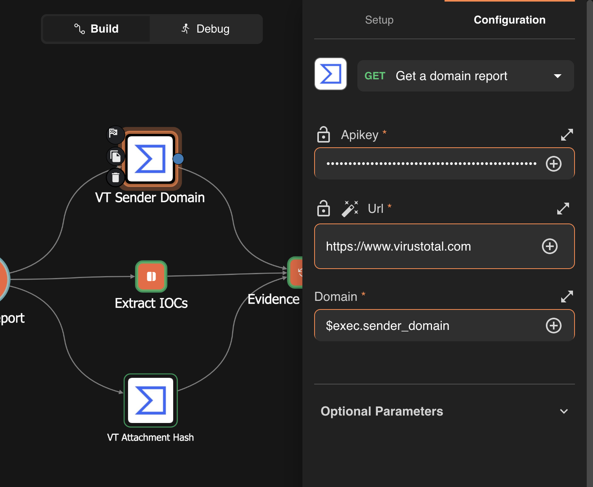
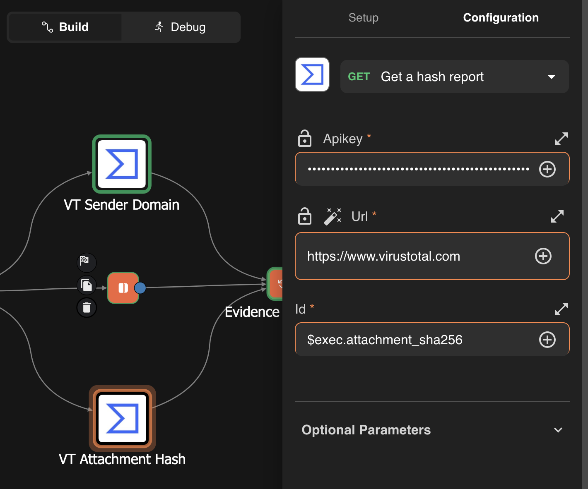
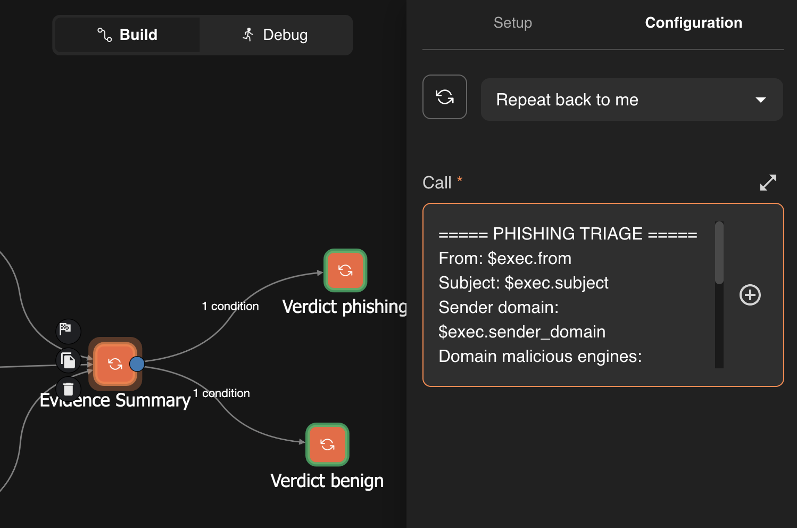
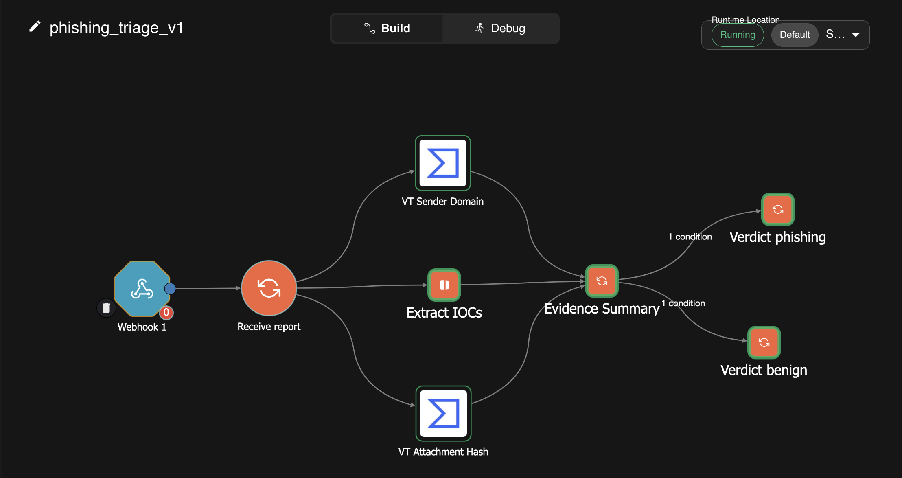
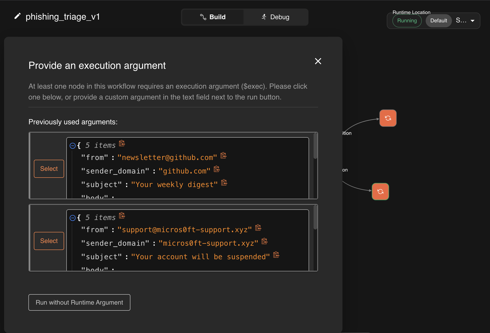
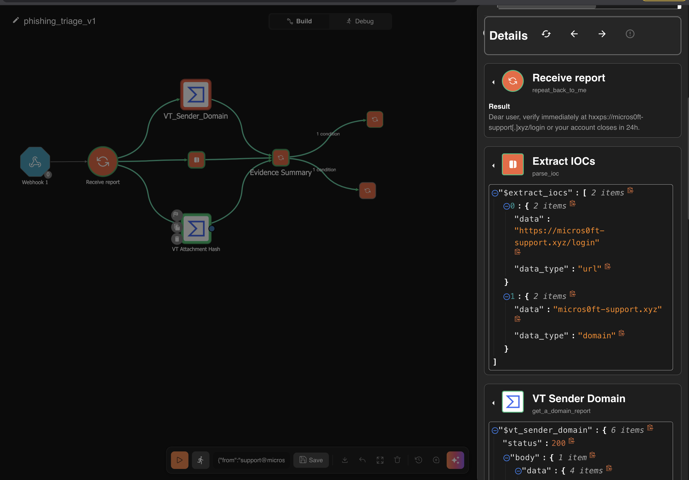
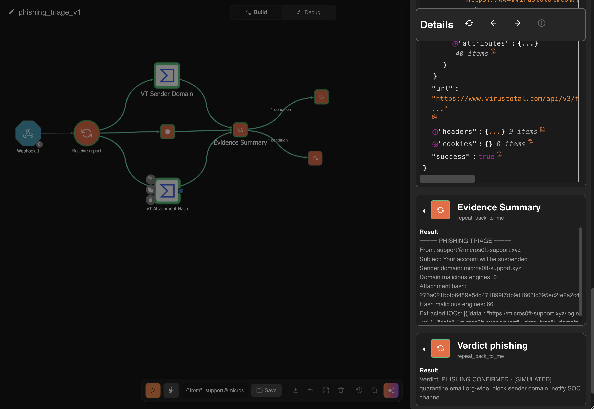
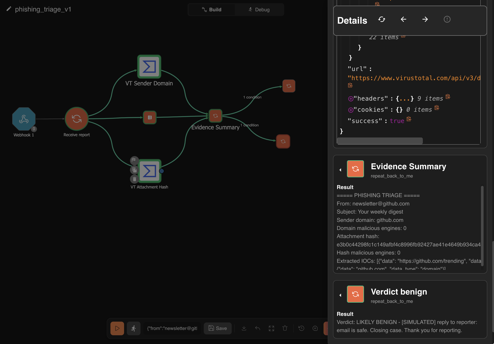

# Chapter 5: Phishing Response Automation

The payoff chapter. In Lab 1 you mapped ~60 minutes of manual phishing triage. Today you build `phishing_triage_v1`, which does the mechanical core of it in seconds. This reuses everything you know — webhook, parallel enrichment, join, conditioned branches, evidence-carrying verdicts — and adds two new skills: IOC extraction from unstructured text, and file-hash reputation.

---

## Before you start

```bash
docker ps --format '{{.Names}}\t{{.Status}}' | grep -E "frontend|backend|opensearch|orborus"
docker inspect shuffle-backend --format '{{range $k,$v := .NetworkSettings.Networks}}{{$k}} {{end}}'
```

The second must list **both** networks. If not:

```bash
docker network connect shuffle_swarm_executions shuffle-backend
```

---

## 5.1 The problem shape

A reported phishing email is unstructured data: a blob of text containing zero or more URLs, maybe attachments, a sender address that may be spoofed. Before any enrichment can happen, the playbook must extract the checkable artifacts — **IOCs** (Indicators of Compromise): URLs, domains, IPs, file hashes.

In Chapter 4 the webhook handed you a clean `src_ip` field. Real life isn't that polite; parsing is the new skill here.

Shuffle Tools has a `parse_ioc` action that regex-hunts a text blob and returns every URL, domain, IP and hash it finds — including **defanged** ones (`hxxps://`, `micros0ft[.]xyz`). Analysts defang IOCs to make them unclickable, so a good parser must refang them.

## 5.2 The design

```
TRIGGER: Webhook receives reported email as JSON:
         {"from","subject","body","sender_domain","attachment_sha256"}
   │
   ▼
START NODE: Receive_report  (Shuffle Tools, repeat back to me)
   │
   ├─► Extract IOCs      — Shuffle Tools parse_ioc on $exec.body   ┐
   ├─► VT Sender Domain  — VirusTotal domain report                ├ parallel
   ├─► VT Attachment Hash— VirusTotal hash report                  ┘
   │
   ▼
JOIN: Evidence Summary (all three feed into it)
   │
   ├─► CONDITION: hash malicious > 2 ?
   │       YES ▼                              NO ▼
   │   Verdict: PHISHING CONFIRMED       Verdict: LIKELY BENIGN
```

> **Correction to the original design.** The draft said to connect all three enrichment nodes directly to the webhook. That does not work in Shuffle — a trigger hands control to exactly ONE start node, and every sibling is silently skipped with `"Skipped because it's not under the startnode"`. This is the Chapter 4 failure repeated three times over. Parallelism comes from **one node fanning out to three**, so a `Receive_report` start node sits between the webhook and the enrichment layer.

Two honest simplifications, stated up front like a real design doc:

1. **Quarantine and user notification are simulated** as verdict text. Your lab has no mail gateway. Chapter 8 wires real response actions via TheHive. The decision logic — the hard part — is real.
2. **We branch on the attachment hash** because it gives the cleanest deterministic signal for testing. The URL/domain intel still gets collected and displayed in the evidence block, same pattern as Chapter 4's AbuseIPDB score.

## 5.3 Your test ammunition: EICAR

You can't email yourself real malware. The industry solved this decades ago with **EICAR** — a harmless 68-byte text file that every antivirus engine detects as malicious *on purpose*, so people can test detection pipelines safely.

| Purpose | SHA256 |
|---|---|
| **Malicious** (EICAR) | `275a021bbfb6489e54d471899f7db9d1663fc695ec2fe2a2c4538aabf651fd0f` |
| **Clean** (empty file) | `e3b0c44298fc1c149afbf4c8996fb92427ae41e4649b934ca495991b7852b855` |

Two hashes, two guaranteed opposite verdicts, zero risk. This is how real SOC engineers smoke-test pipelines.

## 5.4 Build it

### Step 1 — New workflow: `phishing_triage_v1`

### Step 2 — Webhook trigger

Drag it on, copy the URI, click **Start**.

### Step 2b — Start node (required, see the correction above)

Drag a **Shuffle Tools** node, action **Repeat back to me**, message `$exec.body`. Rename it `Receive_report`. Connect **Webhook → Receive_report** and set it as start node.

From here on, **name every node by its job**. `Shuffle Tools 2` tells future-you nothing, and the node name becomes the variable name you reference later.

### Step 3 — IOC extraction

Drag **Shuffle Tools**, connect from **Receive_report**. Rename `Extract_IOCs`.

- Action: **Parse ioc**
- Field name is **`input_string`** (not "input data"): set it to `$exec.body`
- Leave `input_type` at its default

### Step 4 — Sender domain reputation

Drag **Virustotal v3**, connect from **Receive_report**. Rename `VT_Sender_Domain`.

- Action: **Get a domain report**
- `domain` field: `$exec.sender_domain`

We pass the domain pre-split in the payload. Splitting `from` into a domain inside Shuffle is string-surgery that gets much easier with Python in Chapter 7.

<p></p>

*`VT_Sender_Domain`: domain report on `$exec.sender_domain`.*


### Step 5 — Attachment hash reputation

Drag **Virustotal v3** again, connect from **Receive_report**. Rename `VT_Attachment_Hash`.

- Action: **Get a hash report** — in the API this is `get_a_hash_report_`. There is no action called "Get a file report" in this app version; the file-named actions only handle comments and uploads.
- The field is called **`id`**, not `hash`. Set it to `$exec.attachment_sha256`

<p></p>

*`VT_Attachment_Hash`: the action is "Get a hash report" and the field is `id`.*


### Step 6 — Evidence join

Drag **Shuffle Tools**, rename `Evidence_Summary`. Connect **all three** upstream nodes into it. Action **Repeat back to me**:

```
===== PHISHING TRIAGE =====
Reporter email from: $exec.from
Subject: $exec.subject
Sender domain: $exec.sender_domain
Domain malicious engines: $vt_sender_domain.body.data.attributes.last_analysis_stats.malicious
Attachment hash: $exec.attachment_sha256
Hash malicious engines: $vt_attachment_hash.body.data.attributes.last_analysis_stats.malicious
Extracted IOCs: $extract_iocs
```

Remember the scoping rule from Chapter 4: a node can only reference results from its own **ancestors**. That is why all three enrichment nodes must converge here before any of their values can be combined.

<p></p>

*`Evidence Summary` building the triage block, with its two conditioned verdict edges.*


### Step 7 — Verdicts

Two Shuffle Tools nodes hanging off the join, with conditions on the edges testing the hash count:

| Node | Edge condition |
|---|---|
| `Verdict_phishing` | `$vt_attachment_hash.body.data.attributes.last_analysis_stats.malicious` **larger than** `2` |
| `Verdict_benign` | same source, **less than** `3` |

> **Correction — found in Chapter 9.** This edge fails open. If the lookup fails (a dead API key,
> a rate limit, an invalid input), the malicious count comes back empty, Shuffle compares it as
> 0, and `less than 3` passes — so the run auto-closes as clean. A clean verdict must also require
> proof the lookup worked (`$node.status` equals `200`), with failures routed to a human. See
> `brute_force_response_v3` and [`evidence/ch09-01-dead-key-fails-open.png`](../evidence/ch09-01-dead-key-fails-open.png).

Give each the full evidence block plus its verdict line:

- **Phishing:** `PHISHING CONFIRMED - [SIMULATED] quarantine email org-wide, block sender domain, notify SOC channel.`
- **Benign:** `LIKELY BENIGN - [SIMULATED] reply to reporter: email is safe. Closing case.` Thank the reporter — reporting behaviour must be rewarded.

**Save.**

<p></p>

*The finished `phishing_triage_v1`: three parallel enrichments, a join, and two verdicts.*


## 5.5 Fire it

**Malicious test.** The body contains a defanged URL for your parser to find:

```bash
curl -k -X POST https://localhost:3443/api/v1/hooks/YOUR_WEBHOOK_ID \
  -H "Content-Type: application/json" \
  -d '{
    "from": "support@micros0ft-support.xyz",
    "sender_domain": "micros0ft-support.xyz",
    "subject": "Your account will be suspended",
    "body": "Dear user, verify immediately at hxxps://micros0ft-support[.]xyz/login or your account closes in 24h.",
    "attachment_sha256": "275a021bbfb6489e54d471899f7db9d1663fc695ec2fe2a2c4538aabf651fd0f"
  }'
```

**Benign test.** A colleague over-reported a newsletter:

```bash
curl -k -X POST https://localhost:3443/api/v1/hooks/YOUR_WEBHOOK_ID \
  -H "Content-Type: application/json" \
  -d '{
    "from": "newsletter@github.com",
    "sender_domain": "github.com",
    "subject": "Your weekly digest",
    "body": "See what is trending this week at https://github.com/trending",
    "attachment_sha256": "e3b0c44298fc1c149afbf4c8996fb92427ae41e4649b934ca495991b7852b855"
  }'
```

Watch the execution: parse fires, both VT lookups run in parallel, evidence joins, exactly one verdict lights up.

<p></p>

*The malicious and benign test payloads.*

<p></p>

*`parse_ioc` refangs `hxxps://micros0ft-support[.]xyz/login` into a URL and a domain.*

<p></p>

*EICAR hash: 66 engines → **PHISHING CONFIRMED**. The sender domain scores 0.*

<p></p>

*GitHub newsletter with an empty-file hash → **LIKELY BENIGN**.*


---

## 🧪 Lab 5: Deliverables

1. **Screenshot:** full canvas with renamed nodes. This is now a graded habit.
2. **Screenshot:** malicious run — `Extract_IOCs` output showing it found and refanged the defanged URL, plus the PHISHING verdict with evidence.
3. **Screenshot:** benign run — the BENIGN verdict fired.
4. **Written:**
   - a) What did `parse_ioc` return for the malicious email — did it catch `hxxps://micros0ft-support[.]xyz/login`, and what did it output?
   - b) What were the domain-malicious and hash-malicious counts in both runs?
   - c) The playbook branches only on the hash. Describe one realistic phishing email that would slip through as benign — and which collected but unused signal would have caught it.

**Bonus (hard, optional):** add a second conditioned edge from the join into `Verdict_phishing` so an email is also marked PHISHING when the sender domain malicious count ≥ 3, even if the hash is clean. Think about why two edges into one node creates an effective OR.

---

**Blind spots.** Question 4c is the important one. It is the "what are your automation's blind spots?" question, and knowing your playbook's blind spots is the difference between an engineer and a tool-operator.
