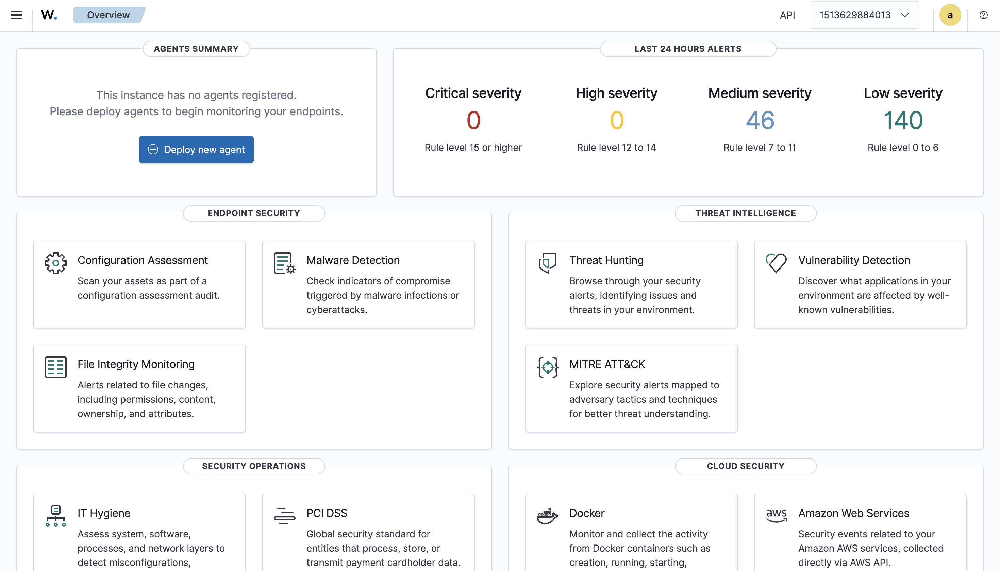
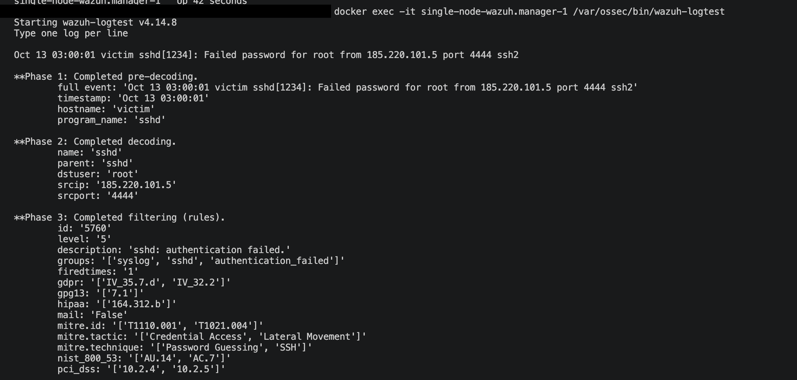
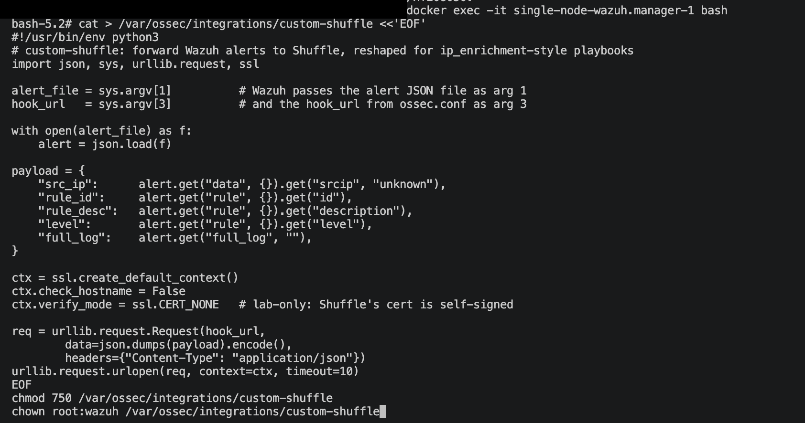
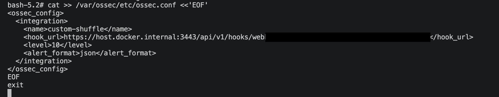
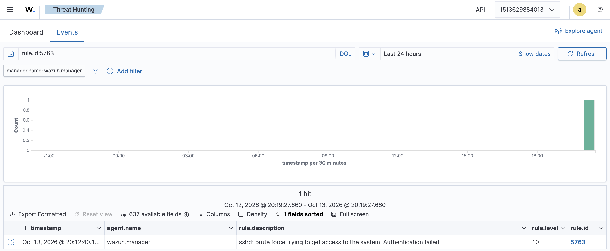
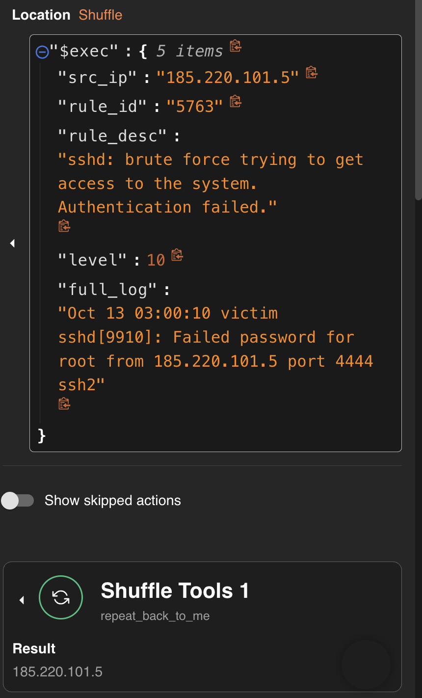
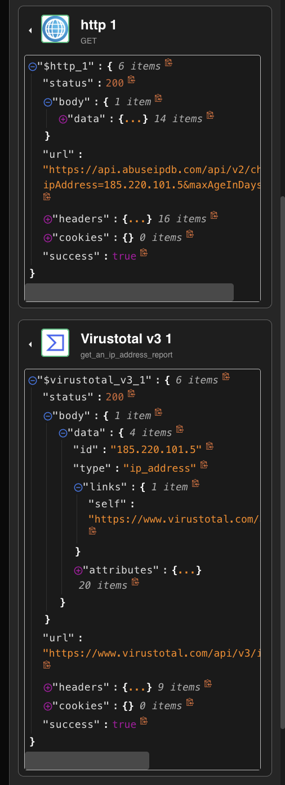
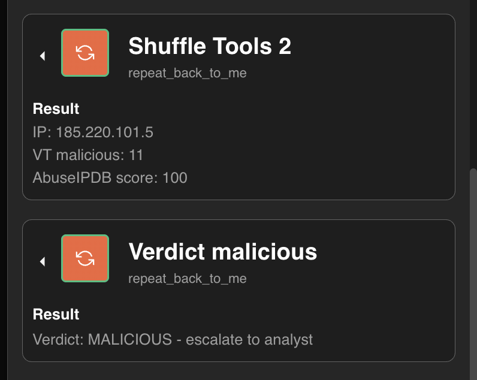

# SOAR Professional Track

## Chapter 6: SIEM Integration ✅ COMPLETED

> The training wheels come off: until this chapter, every playbook run started with a human `curl`. Now a real SIEM (**Wazuh 4.14.8**) watches logs, detects a brute-force attack, and fires the Shuffle playbook itself.
>
> **End state achieved:** `SSH failures in a log → Wazuh decodes → correlated brute-force alert (rule 5763, level 10) → integrator POSTs to Shuffle webhook → VT + AbuseIPDB enrichment → Verdict: MALICIOUS` — zero humans in the loop.

---

## 6.0 Pre-Flight (and What It Caught)

Before deploying, the plan was validated against the actual environment. Three clashes found **before** any command ran — this is why pre-flight exists:

| Issue | Would have caused | Fix applied |
|---|---|---|
| `-b stable` branch doesn't exist in wazuh-docker | clone fails | pin to release tag **`-b v4.14.8`** (pinned versions also make labs reproducible) |
| Host port **9200** already published by Shuffle's OpenSearch | indexer: "port is already allocated" | remap to **`9201:9200`** |
| Host port **1514** held by tenzir-node (Shuffle stack) | manager fails to start | remap to **`1516:1514`** (agent port — unused anyway, this lab replays logs) |

Host-side remaps only: inside Docker, Wazuh's components still talk on their normal ports. Docker Desktop memory raised to 10 GB for headroom (Shuffle ~3 GB + Wazuh ~3 GB).

> ⭐ **Lesson:** assumptions about someone else's Docker environment are guesses until verified. A 10-second port check beats 20 minutes of cleanup.

## 6.1 Deploy the Stack

```bash
git clone https://github.com/wazuh/wazuh-docker.git -b v4.14.8
cd wazuh-docker/single-node
sed -i '' 's/"9200:9200"/"9201:9200"/; s/"1514:1514"/"1516:1514"/' docker-compose.yml

docker compose -f generate-indexer-certs.yml run --rm generator   # certs FIRST
docker compose up -d
```

Three containers: `wazuh.manager` (detection engine), `wazuh.indexer` (OpenSearch storage), `wazuh.dashboard` (UI). Browser → https://localhost → default login the shipped default admin account (password in the Wazuh docker-compose file) — **shipping defaults are a vulnerability**; fine on localhost, step-zero change anywhere real.

### ✅ Evidence — dashboard up:



Note the alert counters: **46 medium + 140 low in 24h with zero agents and no attacks** — a SIEM monitoring only itself. Real SIEM noise levels, firsthand.

## 6.2 Detection Theory (as Observed)

Pipeline: **logcollector** reads files → **decoders** parse lines into fields → **rules** match and assign a level (0–15).

The chapter predicted rules 5710/5712; this ruleset version fires **5760/5763** — IDs drift across ruleset versions, which is exactly why detection logic is tested in isolation before any plumbing:

- **Rule 5760** (level 5): atomic — one `Failed password` event. *"sshd: authentication failed."*
- **Rule 5763** (level 10): **correlated** — fires when 5760-type events repeat from the same source in a short window. *"sshd: brute force trying to get access to the system."*

### ✅ Evidence — `wazuh-logtest` before wiring anything:



Decoder extracted `srcip: 185.220.101.5`, `dstuser: root`; rule **5760, level 5** matched — and carries **MITRE ATT&CK** mappings (`T1110.001 Password Guessing — Credential Access`) plus PCI-DSS / HIPAA / GDPR tags. SIEM alerts plug directly into compliance and ATT&CK frameworks.

## 6.3 Monitored File + Log Replay

No agent fleet → **log replay**: append realistic sshd lines to a file the manager watches (`/var/log/test.log`, registered as a syslog `<localfile>` in `ossec.conf`). The lines are simulated; decoding, correlation, and alerting are 100% real.

## 6.4 Wazuh → Shuffle: the Integrator

Wazuh's **integrator** runs a script from `/var/ossec/integrations/` (must be named `custom-*`) whenever an alert matches configured criteria, passing the alert JSON.

**Shuffle side:** `brute_force_response_v1` = Save-As of `ip_enrichment_v1` (it already does IP → VT + AbuseIPDB → join → verdict) with a started webhook.

**The payload adapter** (`custom-shuffle`, Python): Wazuh's alert JSON doesn't look like `{"src_ip": ...}`, so the script reshapes at the source instead of forking the playbook — `.get()` chains with defaults throughout (Chapter 7 skill 1), TLS verification bypassed **lab-only** for Shuffle's self-signed cert.



**ossec.conf integration block:**



Two load-bearing choices:

- **`host.docker.internal:3443`** — Wazuh and Shuffle live in different Docker networks; this hostname is Docker Desktop's route back to the host, where Shuffle publishes 3443.
- **`<level>10</level>`** — only the *correlated* alert (5763) wakes the SOAR. Atomic failures stay in the SIEM.

## 6.5 🔫 The Attack

Ten `Failed password` lines from 185.220.101.5, one second apart, appended to the monitored log. Dominoes:

### ✅ Wazuh: one correlated alert



Ten atomic events in → **1 hit**, rule **5763**, level **10** out.

### 🏆 Shuffle: an execution nobody curled



`$exec` carries the adapter's payload: `src_ip: 185.220.101.5`, `rule_id: "5763"`, `level: 10`, the original sshd line in `full_log`.

### ✅ Enrichment + verdict, end to end





**VT malicious: 11 · AbuseIPDB: 100 → MALICIOUS — escalate to analyst.**

> Note: VT said **12** for this same IP in Chapter 4, **11** today. Engine verdicts drift — reputation is a living signal, not a constant.

---

## ✅ Lab 6 Written Answers (student's own, refined)

**a) Why `<level>10</level>` instead of forwarding everything?** So the SOAR isn't flooded — only the alerts worth acting on are forwarded, processed one by one as needed. Concretely: this idle lab logged ~186 alerts/day doing nothing; forwarding low levels would fire a playbook (and a VirusTotal call, quota 500/day) per alert — one quiet day wipes the quota, one noisy day turns the SOAR into its own DoS. **Filter at the source.**

**b) Why did 5760 fire ten times but 5763 once, and why subscribe to 5763?** 5760 is **atomic** — it fires on every single failed login. 5763 is **correlated** — it links multiple failures from the same source into one pattern, which gives much higher confidence it's actually brute force. The pattern, not the event, is the right subscription point for automation.

**c) Why does the integration script exist?** A **data-format mismatch**: Wazuh has its field names, Shuffle's playbook expects its own (`src_ip`). The script **normalizes** one to the other without losing information — the *payload adapter* pattern. Reshape at the integration boundary; never fork the playbook per alert source.

---

## 📝 Active Recall Check

1. Name the three Wazuh components and each one's job.
2. Atomic vs correlated rule — which does SOAR subscribe to, and why?
3. What does `host.docker.internal` solve in this setup?
4. Why must alert-volume filtering happen at the SIEM side of the integration?
5. What is the payload adapter pattern and where does it live?
6. Why did the lab's rule IDs differ from the chapter's draft, and which habit absorbed that without breaking anything?

---

## Pipeline Achieved (the Chapter 1 diagram, running)

```
log line → logcollector → decoder (srcip, user) → rule 5760 ×10 (atomic)
        → rule 5763 ×1 (correlated, level 10)
        → integrator: custom-shuffle (payload adapter)
        → Shuffle webhook → VT ∥ AbuseIPDB → join → Verdict: MALICIOUS
```

*Next: **Chapter 8 — Case Management & Response Actions**: TheHive joins the stack, and the MALICIOUS verdict starts opening real cases and taking gated containment actions instead of printing text.*
