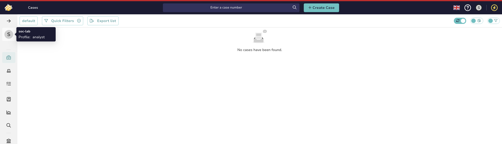
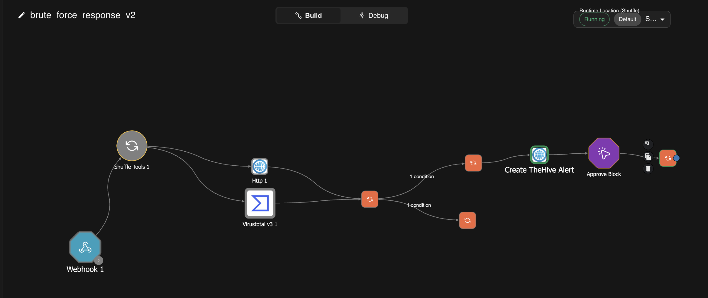
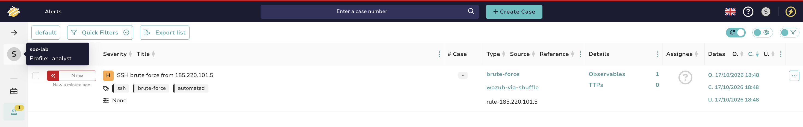
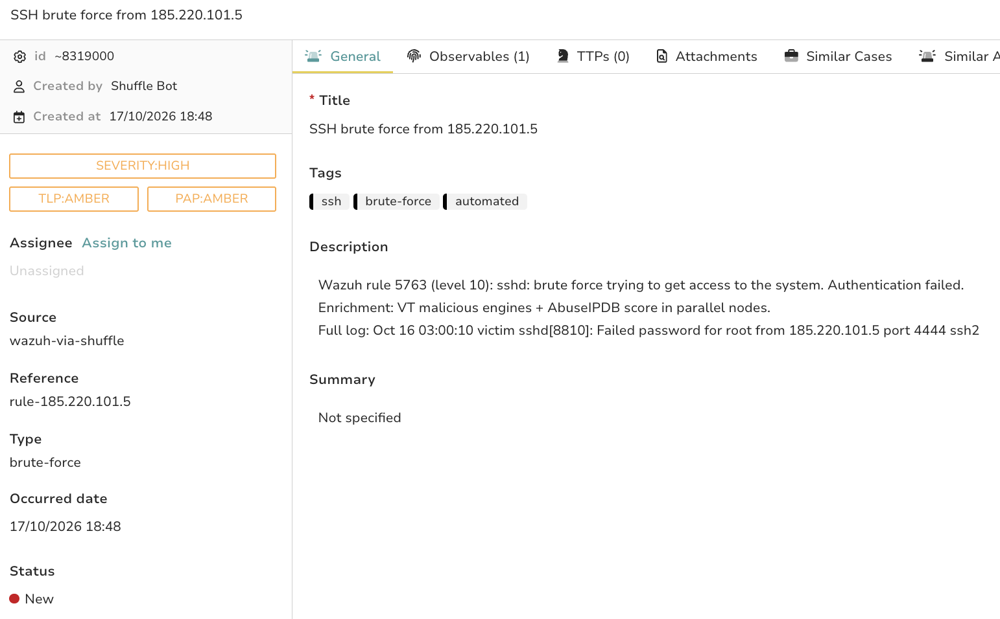
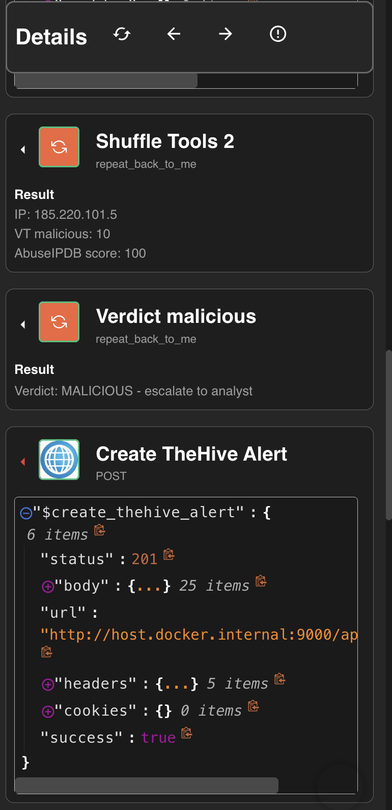
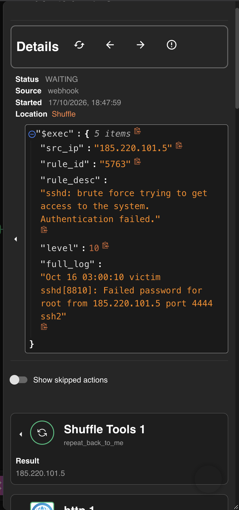
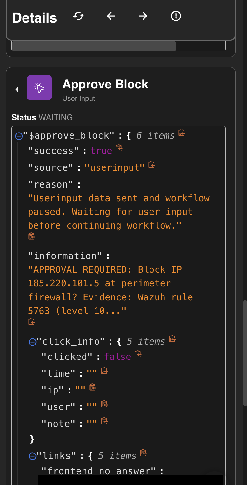
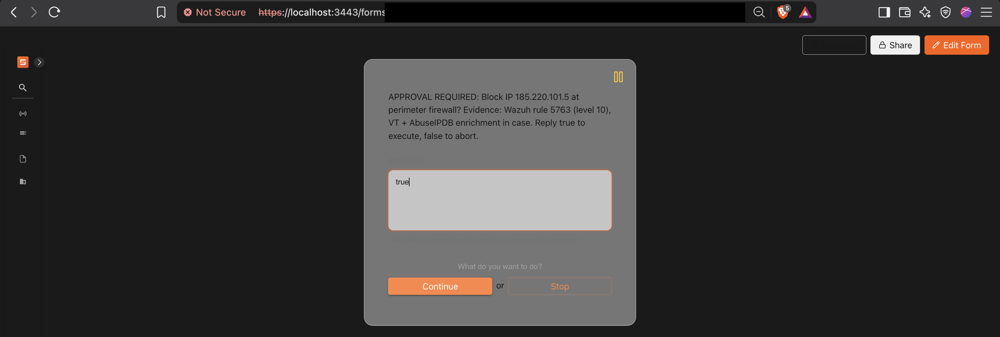
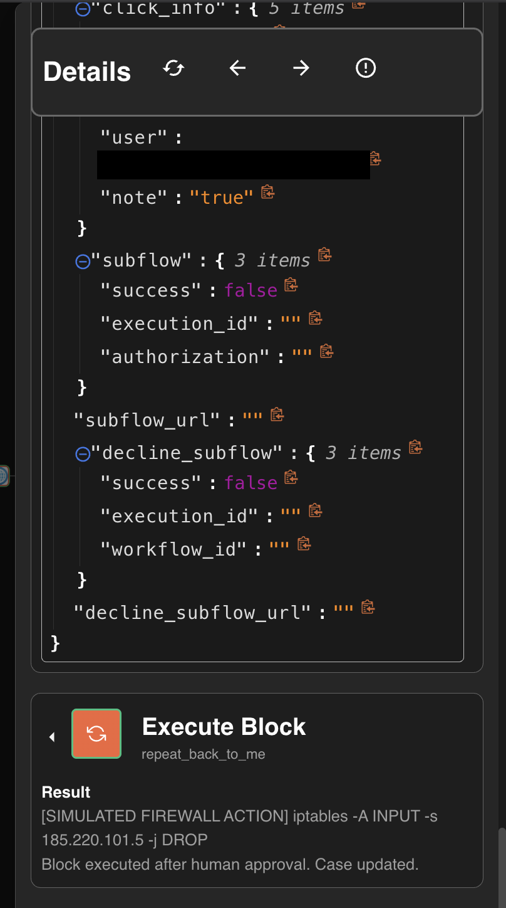
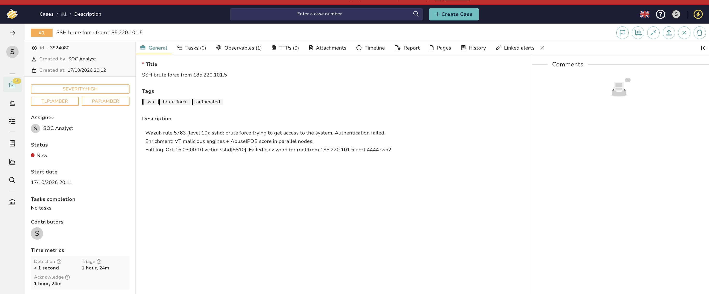

# SOAR Professional Track

## Chapter 8: Case Management & Response Actions ✅ COMPLETED

> The verdict stops being printed text. **TheHive 5** joins the stack; the MALICIOUS path now opens a real alert with structured observables, and the response action sits behind a **human-approval gate** — Chapter 2's golden rule (*automate the investigation, gate the destruction*) implemented for real.
>
> **Pipeline achieved (five systems):** `Wazuh 5763 → integrator → Shuffle enrichment → verdict MALICIOUS → TheHive alert (HTTP 201) → ⏸ workflow FROZEN at approval gate → human approves → block executes, approver audit-logged.`

---

## 8.0 Pre-Flight + Licensing Honesty

Port **9000** checked clear before deploy (the Chapter 6 habit). Ecosystem fact worth knowing for interviews: **TheHive 4 was AGPL open source; TheHive 5 moved to StrangeBee's free-to-use Community license** (2 orgs, 2 users/org, 14-day alert retention — irrelevant for a lab, relevant to say you know).

The four-tool stack now running — **Wazuh + Shuffle + VirusTotal/AbuseIPDB + TheHive** — is a classic open-source SOC architecture you can name as a whole.

## 8.1 Deploy

```bash
mkdir thehive-lab && cd thehive-lab
mkdir -p vol/db vol/data vol/index
docker run -d --name thehive -p 9000:9000 \
  -v "$(pwd)/vol/db:/data/db" -v "$(pwd)/vol/data:/data/files" \
  -v "$(pwd)/vol/index:/data/index" strangebee/thehive:5.4
```

First boot initializes the DB (2–4 min). http://localhost:9000, default the shipped default admin account — shipping defaults, lab-only, same lesson as Wazuh.

## 8.2 Humans vs Service Accounts

Org `soc-lab` with two identities:

- **`analyst@soc-lab`** — Normal user, password, works the UI.
- **`shuffle-bot@soc-lab`** — **Service** account, no password, **API key only**. The SOAR authenticates as this, never as a person.

### ✅ Evidence — analyst view (not admin):



> ⭐ This separation paid off visibly below: the auto-created alert says **Created by: Shuffle Bot**; the promoted case says **Created by: SOC Analyst**. Machine triaged, human owns — the audit trail answers "did a human do this or did automation?" at a glance, and a leaked bot key is revoked without touching a person's credentials.

## 8.3 Verdict → Real Alert (raw HTTP, the adapter skill again)

`brute_force_response_v2` = Save-As of v1; malicious branch extended with `Create TheHive Alert`:

- **POST** `http://host.docker.internal:9000/api/v1/alert` (same Docker-networking door as Chapter 6)
- Headers: `Authorization: Bearer <shuffle-bot key>` + `Content-Type: application/json`
- Body: type/source/title/description templated from `$exec`, `severity: 3`, plus:
  - **`sourceRef`** — TheHive's **dedup key**. Must uniquely identify the detection (rule + IP).
  - **`observables`** — IOCs as structured, searchable data (`{"dataType": "ip", "data": "$exec.src_ip", "ioc": true}`), not prose. Observables are institutional memory: "have we EVER seen this IP?" works across every case.

### ✅ Final canvas:



## 8.4 The Human-Approval Gate

Shuffle's **User Input** trigger, dragged mid-flow: `Create TheHive Alert → Approve Block? → Execute Block`. The information text is the 3am analyst's entire decision interface, so it carries the evidence (IP, rule, level, where the enrichment lives). On reaching the node the execution **freezes** (`Status: WAITING`) until a human answers the approval form.

`Execute Block` (simulated firewall): `iptables -A INPUT -s $exec.src_ip -j DROP` — the action is simulated; **the gate is real**.

---

# ✅ Lab 8 Results — VERIFIED

## The alert, created by the bot





Severity HIGH, source `wazuh-via-shuffle`, rule 5763 description + full sshd log, **1 observable** (the IP, flagged IOC), `status: 201` from the API:



VT malicious: **10** · AbuseIPDB: **100**. (VT for this same Tor IP across the course: **12 → 11 → 10**. Three chapters, three values — reputation is a living signal, never a constant.)

## 🏆 The frozen workflow









`Status: WAITING`, `clicked: false` → human answers the form → `click_info` records **who approved and what they typed** → only then does `Execute Block` run. Investigation automated, destruction gated, approval audit-logged.

## The promoted case — and MTTD, measured



Alert → **Promote to case** is the Tier 1 → Tier 2 handoff from Chapter 1, as a button. And the case's time metrics close the course's first loop: **Detection < 1 second**. The MTTD/MTTR story that justified SOAR in Chapter 1 is now a number the platform measures on its own.

> **Correction — found in Chapter 10.** TheHive's *Detection* metric is not MTTD. It measures from
> the alert's `date` field, which this playbook never sets, so TheHive fills in the moment the alert
> arrived — it times TheHive saving its own record. Comparing timestamps directly, detection to
> case was **10.6 s** for this run (Wazuh alert 15:47:58.037 UTC → TheHive alert 15:48:08.678 UTC)
> and 12.1 s on a later run. See [architecture.md](../architecture.md#measured-latency).

## ⚠️ Shipped Bug (kept as a finding — this is what postmortems look like)

The alert's Reference reads `rule-185.220.101.5` — **the `$exec.rule_id` never made it into the sourceRef template**. The dedup key is therefore per-IP only: if this IP later trips a *different* rule (a web attack instead of SSH brute force), TheHive dedups it against this alert and **the new detection is silently swallowed**. The 5b written answer below describes this exact failure mode — written before noticing the bug in the screenshot. Fix: re-insert `$exec.rule_id` via autocomplete in the node.

> **Resolved in Chapter 10.** The cause was Shuffle treating `-` after a variable as part of its
> name, so `rule-$exec.rule_id-$exec.src_ip` silently dropped the rule ID. The reference is now
> `wazuh rule $exec.rule_id from $exec.src_ip`; see
> [`../evidence/ch10-04-thehive-fixed-sourceref.png`](../evidence/ch10-04-thehive-fixed-sourceref.png).

Both dedup failure directions, named: **no dedup** → alert spam during a sustained attack, analyst drowns; **too-coarse dedup** → distinct detections merged, alerts lost.

---

## ✅ Lab 8 Written Answers (student's own, refined)

**a) Why authenticate as `shuffle-bot`, not the analyst account?** So the record always distinguishes SOAR actions from analyst actions — at 3am, "who closed this / who created this" must answer *human or automation* instantly. Plus key hygiene: a leaked service key is revoked alone; it never burns a person's credentials.

**b) What does `sourceRef` protect against?** Duplicate handling going wrong in both directions. Without a distinguishing ref, TheHive treats different detections as the same alert and one gets missed (observed live in this lab's own too-coarse ref); without dedup at all, a sustained attack floods the queue with identical alerts.

**c) Auto-block or gate the perimeter IP block?** Gate it: the SOAR should run with least privilege, and no action that changes a system should execute without a human — consistent with the fail-safe stance taken in Chapter 7. (Production refinement: asset-criticality-based response from Chapter 2 — auto-block where blast radius is small, gate where it isn't.)

---

## 📝 Active Recall Check

1. Alert vs case in TheHive — and which SOC-tier handoff does "promote" represent?
2. Why must the SOAR use a service account, in one 3am sentence?
3. Name both dedup failure directions and which one this lab's bug created.
4. What are observables, and what question do they answer that prose verdicts can't?
5. What does `click_info` capture at the gate, and why does that matter for audit?
6. Which Chapter 1 metric did the case's time metrics measure, and what was the value?

---

*Next: **Chapter 9 — Playbook Design at Scale**: no new containers — error handling, false-positive economics, documentation standards, and hardening everything built so far. Then Chapter 10: enterprise platforms, PCSAE roadmap, portfolio assembly, and the no-notes mock interview.*
