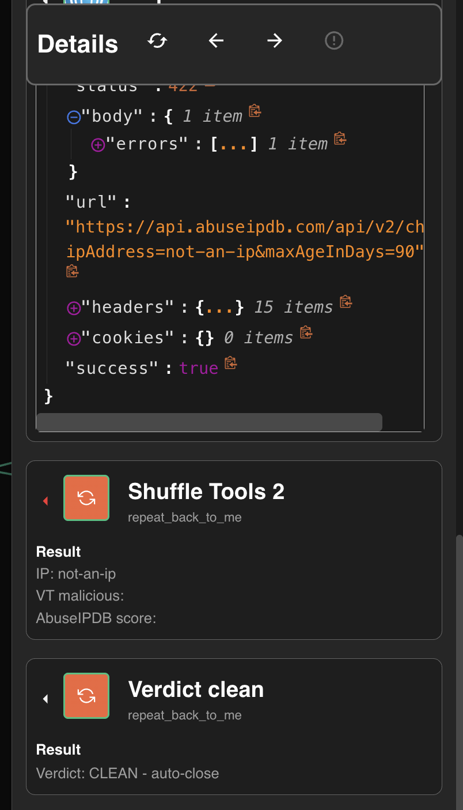
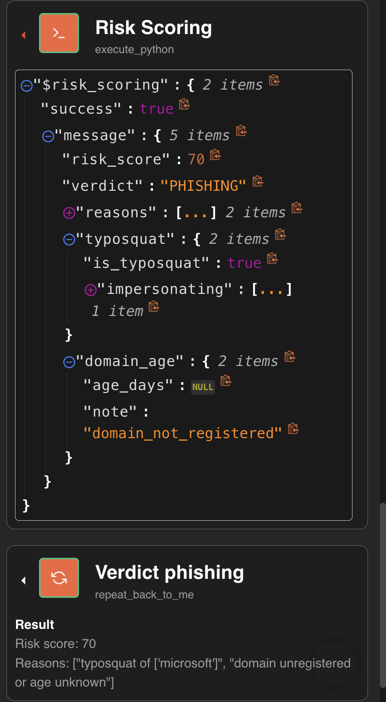
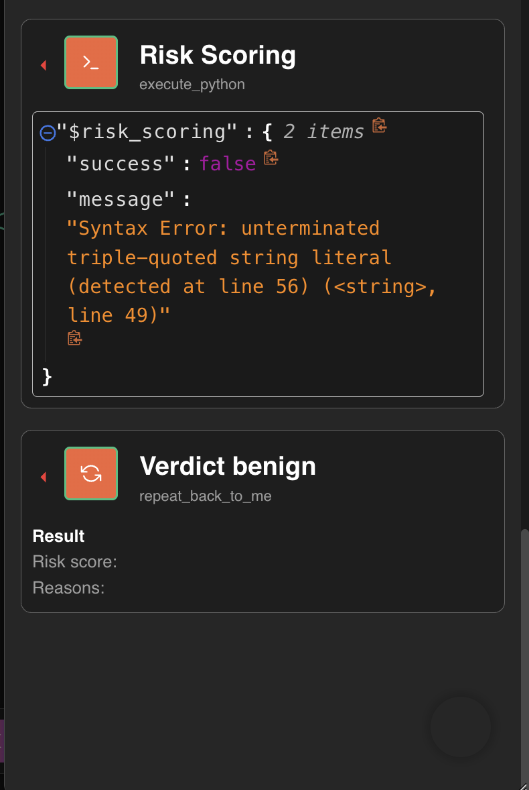
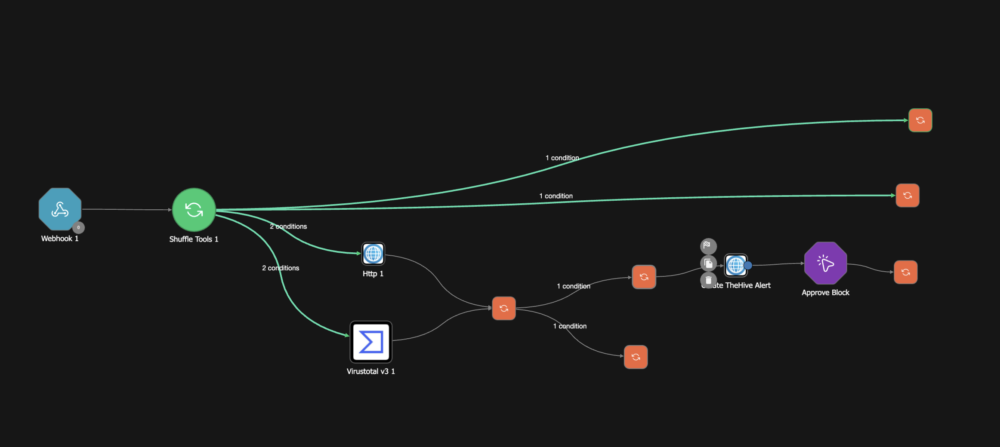
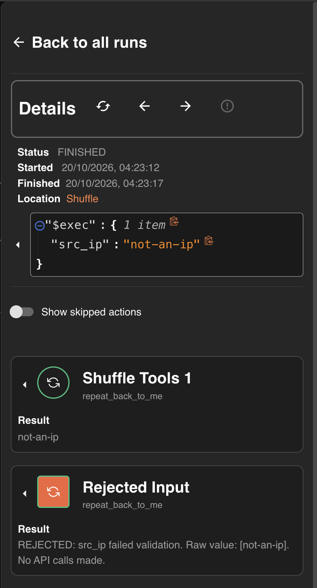
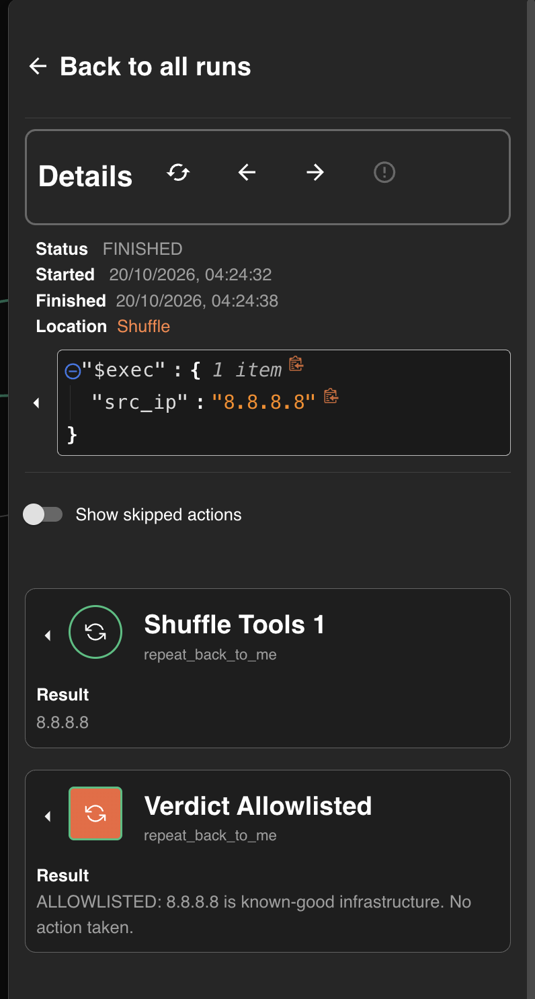

# SOAR Professional Track

## Chapter 9: Playbook Design at Scale ✅ COMPLETED

> No new containers. This chapter asks whether the stack **survives**: production is the 3am when an API key expires, a payload is malformed, or an attacker controls a field you trusted.
>
> **Method:** break our own playbooks on purpose (chaos testing), classify how they fail, then harden.
>
> **Result:** three chaos tests → **three fail-opens** found in the v1/v2 playbooks → `brute_force_response_v3` closes all of them, verified by re-running the same tests.

---

## 9.1 Three Ways to Fail

| Behavior | Name | Meaning |
|---|---|---|
| Crashes, alert lost | **Fail silent** | Nobody knows anything happened |
| Error read as "nothing found" → benign | **Fail open** | The attacker wins because your API key expired |
| Error routed to a human, flagged incomplete | **Fail closed / fail safe** | The automation admits what it doesn't know |

Chapter 7's principle has a mirror image: a failed lookup must make the playbook neither more accusatory **nor more trusting**.

## 9.2 Which Errors to Retry

| Failure | Retry? | Handling |
|---|---|---|
| Timeout / 5xx | ✅ with backoff (2s → 4s → 8s) | Transient |
| **429 rate limit** | ✅ after the window (honor `Retry-After`) | Instant retries make it worse |
| 401 / 403 auth | ❌ never | A dead key won't revive; alert a human loudly |
| 400 / 422 bad input | ❌ never | Validate input before calling anything |
| 404 not found | ❌ not an error | Means "unknown", which is itself a signal (fresh malware looks like this) |

## 9.3 Rate Limits Are a Design Constraint

VT free tier is 4 lookups per minute. If 20 attacker IPs arrive in a minute and 429s fail open, **16 attackers get verdict CLEAN.** Defenses, in order of elegance: **correlate upstream** (SIEM rules collapse events into alerts), **cache before querying** (check whether TheHive already holds the IP as an IOC observable, which gives free institutional memory and costs no quota), and **queue/throttle** (native in enterprise SOARs).

## 9.4 Input Is Hostile Until Validated

**Layer 1, shape validation at the entrance:** an IP must look like an IP and a SHA256 must be 64 hex characters. Anything else is rejected before any API call or code runs.

**Layer 2, the injection problem.** Shuffle substitutes `$exec` values *into Python source as text*. In phishing triage the sender domain is attacker-controlled, so a quote character can close the string early and turn the rest of the input into code. The fix is **allowlist validation** (`^[a-z0-9.-]+$`), which leaves no quote to break out with. Mature platforms pass script arguments as *data*, never spliced into code. Ask any SOAR vendor how they do it.

## 9.5 False-Positive Economics

95% accuracy on 1,000 alerts/day = **50 wrong verdicts daily.** False positives erode analyst trust (alert fatigue caused by your own automation); false negatives are silent breaches. Controls: **allowlists** for known-good infrastructure, **measured** accuracy (compare playbook verdicts with TheHive's final TP/FP case resolutions), and **asymmetric thresholds**, where auto-closing requires more confidence than escalating.

## 9.6 Version Discipline

Playbooks are code: export the JSON into git, version every change (`_v1 → _v2 → _v3`, never edit in place), and give every playbook a README covering triggers, integrations, actions, human gates, failure modes, known limits and a changelog.

---

# ✅ Lab 9 Results: VERIFIED

## Part A: Chaos Tests (three fail-opens found)

### 🔴 Test 1: Dead VT key → CLEAN on a known attacker

VT returned `401 WrongCredentialsError`, the VT field went empty, and the verdict was **CLEAN – auto-close** for the Tor exit node, while AbuseIPDB's **100** sat in the same summary. The branch listened only to VT. **The playbook told an analyst to auto-close a known attacker because its own API key was broken.**

### 🔴 Test 2: Garbage input → CLEAN

`src_ip: "not-an-ip"` → AbuseIPDB **422**, both enrichment fields empty → **CLEAN**.

### 🔴 Test 3: One quote character → crash → benign

Control run (normal payload, scores 70 / PHISHING):

Injection probe (`micros0ft"support.xyz`):

`SyntaxError: unterminated triple-quoted string`. The code had already moved to **triple quotes**, a sturdier quoting style, and one attacker-supplied character still broke the parser. The crashed node (`success: false`) then routed to **Verdict benign** with an empty score: the scoring engine failed and the email was declared safe.

> ⭐ **Key discovery: `"success": true` lies.** In tests 1 and 2 the nodes reported `success: true` while carrying a 401 and a 422. In Shuffle, "success" means *the HTTP request completed*, not *the API gave a usable answer*. **Branch on the API's status code and on whether the field you need is present, never on the platform's success flag.**

## Part B: `brute_force_response_v3` (all three closed)

Validation and allowlist edges come off the entrance node **before** enrichment fans out.

### ✅ Input gate: garbage rejected, zero API calls

### ✅ Allowlist: known-good infrastructure never scored

The Chapter 3 ThreatFox false positive on 8.8.8.8 can now never produce a block recommendation.

### ✅ Fail closed: same dead key, opposite outcome

*"ENRICHMENT FAILED – human review required. VirusTotal returned HTTP 401… Do NOT treat as clean."* This is the same input that produced CLEAN in test 1.

### Known limit carried forward

`phishing_triage_v2` still contains the injection path and the crash-to-benign edge. Hardening it (domain allowlist validation + a failure edge on `Risk Scoring`) is on the Chapter 10 cleanup list.

> **Update — Chapter 10.** Done in `phishing_triage_v3`: the injection payload now stops at
> `Rejected Domain` before any code runs. A fourth fail-open was also found after this chapter —
> a payload with no `src_ip` at all closed as CLEAN. And the dead-key fix was **not** carried into
> the phishing playbook, so it can still fail open there. See [`../evidence/`](../evidence/README.md).

## Part C: README + JSON Export

Moved into Chapter 10's portfolio assembly, where the repo it belongs in is created.

---

## ✅ Lab 9 Written Answers (student's own, refined)

**a) Which tests failed open, and why is that worse than failing silent?** All three. The mechanism: VirusTotal and AbuseIPDB still return a response when something is wrong, so the failure looks like success and is hard to detect. Fail-open is worse than fail-silent because a silent crash leaves a visible gap someone may notice, while a fail-open produces a **confident wrong answer that closes the case** and looks exactly like normal operation.

**b) VT returns 429; a colleague adds "retry 10 times immediately."** All ten retries land in the same rate-limit window and fail, and on some APIs they extend the penalty. Correct handling: honor the **`Retry-After`** header, back off exponentially, and queue the work. A paid higher tier is a legitimate fix. *(Rotating free accounts to dodge the limit is not: it breaks the provider's terms.)*

**c) Why does allowlist validation beat escaping?** A known-good list is a closed set we control, while trying to block every dangerous input is an open set the attacker controls. Proven in test 3: escalating to triple quotes still broke on one character.

**d) Auto-close at 98% accuracy on 500 alerts/day.** **10 wrong closures per day**, about 70 a week and roughly 3,650 a year. Auto-close needs the higher bar because a closed case never reaches an analyst: if suspicious activity is closed as a false positive, nobody knows, or they find out too late.

---

## 📝 Active Recall Check

1. Define fail silent, fail open, and fail closed. Which did all three chaos tests produce in v1/v2?
2. Why can't you trust Shuffle's `success: true`, and what should a condition branch on instead?
3. Which HTTP errors deserve a retry, which never do, and why is a 404 from a reputation API not an error?
4. Explain how a single character in an email header could execute code in the SOAR, and the fix.
5. Why is caching observables in TheHive a rate-limit defense?
6. Why must auto-close require a higher confidence threshold than escalation?

---

*Next: **Chapter 10, Enterprise Platforms & Career**: Splunk SOAR and Cortex XSOAR mapped against everything built here, the PCSAE roadmap, assembling chapters 1–9 into a portfolio repo (the Part C README lands there), hardening `phishing_triage_v2`, and the no-notes mock interview.*
